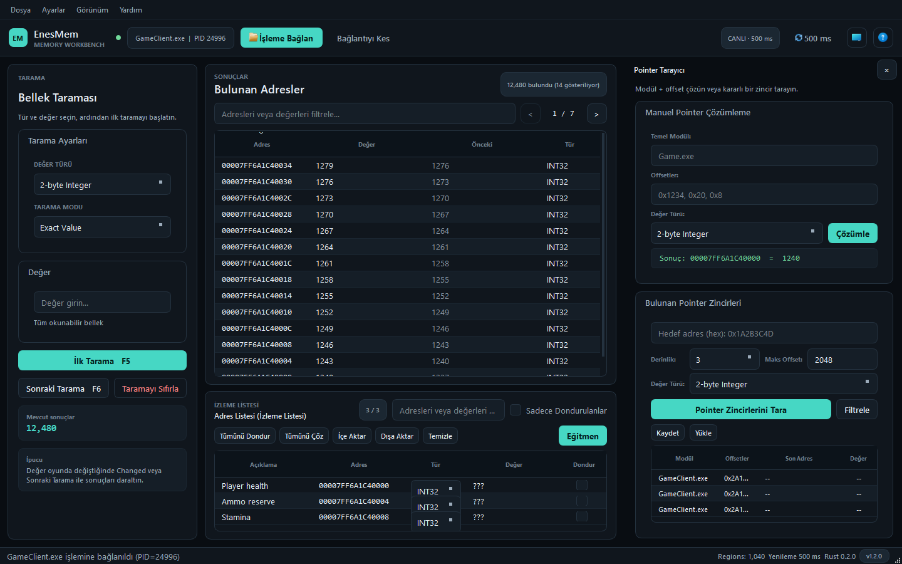
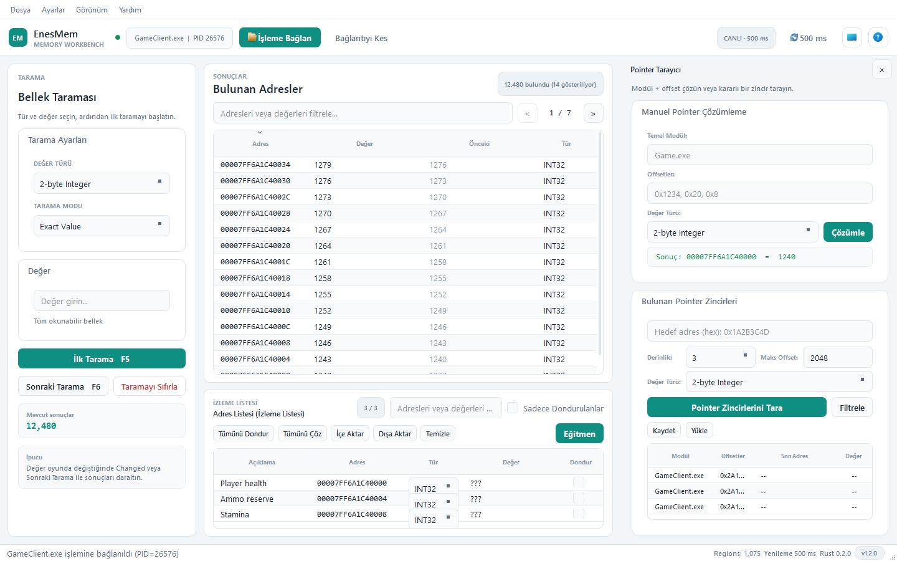

# EnesMem v1.2.0

**Windows x64 için modern bellek tarayıcısı ve düzenleyici.**  
Python + PyQt6 · saf `ctypes` · Rust hızlandırma · koyu/açık arayüz

[🇹🇷 Türkçe](README.md) · [🇬🇧 English](README_EN.md) · [İndir](https://github.com/enes59255X/EnesMem/releases/latest) · [Değişiklikler](CHANGELOG.md)

[](https://github.com/enes59255X/EnesMem/releases/latest)
[](https://github.com/enes59255X/EnesMem/releases/latest)
[](https://www.python.org/)
[](CHANGELOG.md)

<p align="center">
  
</p>

## İndir

| Paket | Boyut | Açıklama |
|---|---:|---|
| **[EnesMem-1.2.0-win64.exe](https://github.com/enes59255X/EnesMem/releases/download/v1.2.0/EnesMem-1.2.0-win64.exe)** | 48.5 MB | Tek dosya; kurulum gerekmez |
| **[EnesMem-1.2.0-win64.zip](https://github.com/enes59255X/EnesMem/releases/download/v1.2.0/EnesMem-1.2.0-win64.zip)** | 34.9 MB | Taşınabilir klasör; daha hızlı açılış |
| **[SHA256SUMS.txt](https://github.com/enes59255X/EnesMem/releases/download/v1.2.0/SHA256SUMS.txt)** | 180 B | İndirme doğrulama |

> **Hızlı açılış istiyorsanız ZIP sürümünü kullanın.** Tek dosya EXE her açılışta
> kendini geçici klasöre çıkarır. Zip'i açıp `EnesMem\EnesMem.exe` dosyasını
> çalıştırın; `_internal` klasörünü exe'den ayırmayın.

### Gereksinimler

- Windows 10/11 **x64**
- Python kurulumu gerekmez (paketli sürüm)
- Yönetici izni: normal kullanıcı süreçleri için gerekmez; korumalı veya
  yönetici olarak çalışan hedefler için önerilir.

> Build imzasızdır. Windows SmartScreen ilk çalıştırmada uyarı gösterebilir:
> **More info → Run anyway**. Bellek tarayıcıları antivirüslerde zaman zaman
> yanlış pozitif üretebilir; kaynak ve release dosyaları bu repodadır.

## Hızlı başlangıç

1. `EnesMem\EnesMem.exe` dosyasını çalıştırın.
2. **İşleme Bağlan** ile hedef oyunu/süreci seçin.
3. Veri türünü ve değeri girin; **İlk Tarama** (F5) çalıştırın.
4. Oyunda değeri değiştirin; **Sonraki Tarama** (F6) ile daraltın.
5. Sonucu çift tıklayıp izleme listesine ekleyin; değeri düzenleyin veya dondurun.

### Kısayollar

| Kısayol | İşlem |
|---|---|
| `F5` | İlk tarama |
| `F6` | Sonraki tarama |
| `Ctrl+R` | Taramayı sıfırla |
| `Ctrl+O` | Süreç seç |
| `Ctrl+M` | Bellek görüntüleyici |
| `Ctrl+Shift+X` | Speedhack |

## Ekran görüntüleri

| Koyu tema | Açık tema |
|---|---|
|  |  |

## Öne çıkanlar

| Alan | Özellikler |
|---|---|
| Tarama | First/next scan, AOB + wildcard, UIV, float tolerance, between |
| Tipler | Int8/16/32/64, UInt, Float, Double, String, Bytes |
| Sonuçlar | Sayfalama, arama, filtre, canlı yenileme, izleme listesi |
| Pointer | Modül + offset çözümleme, zincir tarama, canlı değer |
| Bellek | Hex görüntüleyici, x64 assembly (Capstone), yapı çözümleyici |
| Gelişmiş | HWBP “What writes here”, speedhack, trainer üretimi |
| Arayüz | Koyu/açık tema, Türkçe/İngilizce, üç bölmeli esnek çalışma alanı |

### Tarama modları

`Exact` · `Bigger` · `Smaller` · `Between` · `Increased` · `Decreased` ·
`Changed` · `Unchanged` · `Unknown` · `Increased By` · `Decreased By` ·
`Float Tolerance` · `AOB`

## Performans

Aynı makinede, release Rust çekirdeğiyle ölçülen önce/sonra değerleri:

| İşlem | Önce | Sonra |
|---|---:|---:|
| AOB tarama (4 MB) | 3.96 s | ~0.001 s |
| UIV 2M dword devam taraması | 6.68 s | 0.046 s |
| Next UNCHANGED (300k) | 1.508 s | 0.078 s |
| Next EXACT (300k) | 1.535 s | 0.085 s |
| Pointer tarama (4 MiB) | 0.036 s | 0.002 s |
| Watchlist yenileme | 5.3 ms | 4.4 ms |

> Ölçümler donanıma ve hedef sürecin bellek düzenine göre değişebilir.

## Doğrulama

- **121** Python testi
- **20** Rust testi
- GUI smoke: bağlan → tara → ayır → kapat
- Frozen **onedir** ve **onefile** `--smoke-test` başarılı
- Koyu/açık tema 1440×900’de kontrol edildi

## Geliştirme

```powershell
python -m pip install -r requirements.txt -r requirements-dev.txt
python main.py

# Tüm kapılar: compile + pytest + cargo test + GUI smoke
powershell -ExecutionPolicy Bypass -File scripts\verify.ps1

# Klasör + tek dosya + zip
powershell -ExecutionPolicy Bypass -File scripts\build_exe.ps1
```

## Bilinen sınırlar

- UIV UNCHANGED hâlâ yüksek bellek kullanabilir (~1.70 GiB tepe, 134M sonuç).
- 32-bit hedefler otomatik test kapsamında değildir.
- HWBP ve speedhack hedefe/antivirüse göre değişebilir; yönetici izni gerekebilir.
- Bu araç yalnızca sahip olduğunuz veya test etmek için izin aldığınız süreçlerde
  kullanılmalıdır. Online oyunlarda kullanım hesap/ban riski doğurabilir.

## Lisans

MIT — ayrıntılar için [LICENSE](LICENSE).

---

**EnesMem v1.2.0** · native core **0.2.0** · [Release](https://github.com/enes59255X/EnesMem/releases/tag/v1.2.0) · [Sorun bildir](https://github.com/enes59255X/EnesMem/issues)
