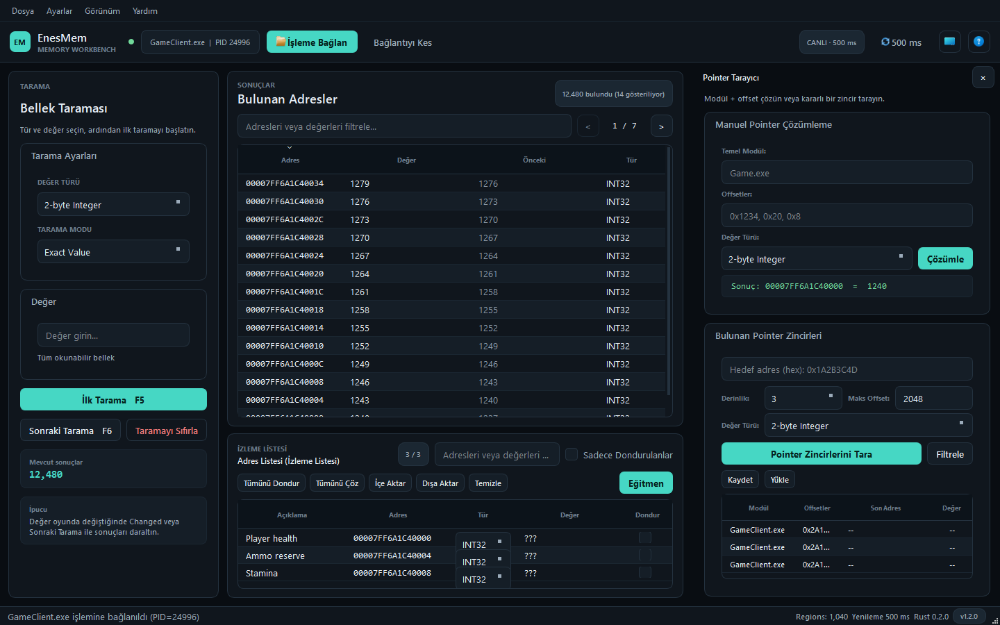
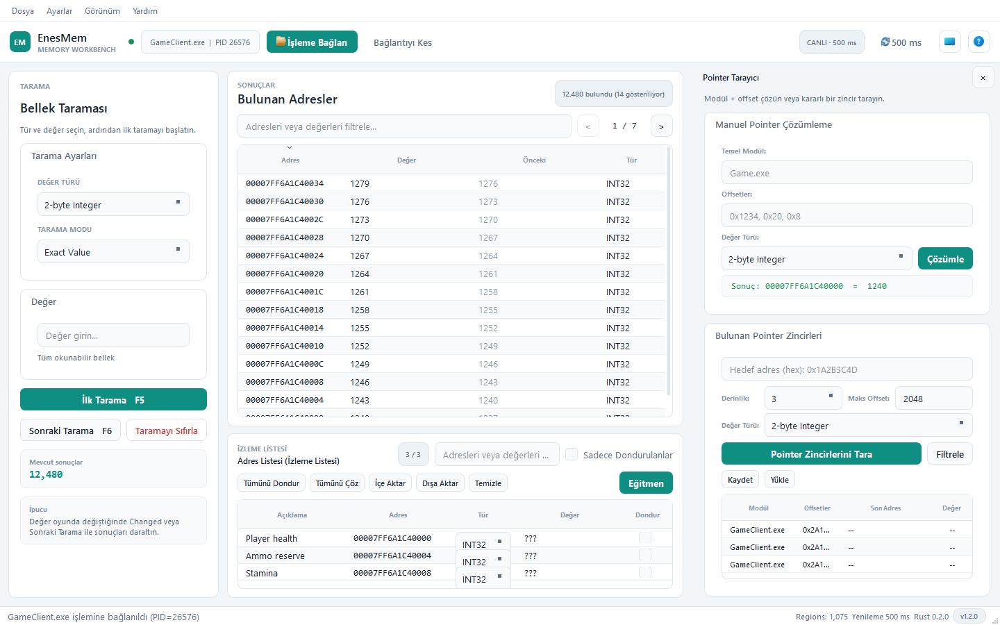

# EnesMem v1.2.0

**A modern memory scanner and editor for Windows x64.**  
Python + PyQt6 · pure `ctypes` · Rust accelerator · dark/light workspace

[🇹🇷 Türkçe](README.md) · [🇬🇧 English](README_EN.md) · [Download](https://github.com/enes59255X/EnesMem/releases/latest) · [Changelog](CHANGELOG.md)

  

## Download

| Package | Size | Description |
|---|---:|---|
| **[EnesMem-1.2.0-win64.exe](https://github.com/enes59255X/EnesMem/releases/download/v1.2.0/EnesMem-1.2.0-win64.exe)** | 48.5 MB | Single file; no installation |
| **[EnesMem-1.2.0-win64.zip](https://github.com/enes59255X/EnesMem/releases/download/v1.2.0/EnesMem-1.2.0-win64.zip)** | 34.9 MB | Portable folder; faster launch |
| **[SHA256SUMS.txt](https://github.com/enes59255X/EnesMem/releases/download/v1.2.0/SHA256SUMS.txt)** | 180 B | Download verification |

> **Use the ZIP if you want the fastest launch.** The single-file EXE extracts
> itself on every start. Extract the ZIP and run `EnesMem\EnesMem.exe`; keep the
> `_internal` folder next to the executable.

### Requirements

- Windows 10/11 **x64**
- No Python installation required (packaged build)
- Administrator: not needed for same-user targets; recommended for protected or
  elevated processes.

> The build is unsigned. Windows SmartScreen may show a warning on first launch:
> **More info → Run anyway**. Memory scanners can occasionally trigger antivirus
> false positives; the release assets live in this repository.

## Quick start

1. Run `EnesMem\EnesMem.exe`.
2. Select the target with **Attach**.
3. Choose a type and value, then run **First Scan** (F5).
4. Change the value in the game; narrow with **Next Scan** (F6).
5. Double-click a result to add it to the watchlist, then edit or freeze it.

### Shortcuts

| Shortcut | Action |
|---|---|
| `F5` | First scan |
| `F6` | Next scan |
| `Ctrl+R` | Reset scan |
| `Ctrl+O` | Select process |
| `Ctrl+M` | Memory viewer |
| `Ctrl+Shift+X` | Speedhack |

## Screenshots

| Dark | Light |
|---|---|
|  |  |

## Highlights

| Area | Features |
|---|---|
| Scanning | First/next scan, AOB + wildcard, UIV, float tolerance, between |
| Types | Int8/16/32/64, UInt, Float, Double, String, Bytes |
| Results | Paging, search, filter, live refresh, watchlist |
| Pointer | Module + offset resolution, chain scan, live values |
| Memory | Hex viewer, x64 assembly (Capstone), structure dissector |
| Advanced | HWBP “What writes here”, speedhack, trainer generation |
| Interface | Dark/light theme, Turkish/English, resizable three-pane workspace |

### Scan modes

`Exact` · `Bigger` · `Smaller` · `Between` · `Increased` · `Decreased` ·
`Changed` · `Unchanged` · `Unknown` · `Increased By` · `Decreased By` ·
`Float Tolerance` · `AOB`

## Performance

Measured on the same machine with the release Rust core:

| Operation | Before | After |
|---|---:|---:|
| AOB scan (4 MB) | 3.96 s | ~0.001 s |
| UIV 2M dword follow-up | 6.68 s | 0.046 s |
| Next UNCHANGED (300k) | 1.508 s | 0.078 s |
| Next EXACT (300k) | 1.535 s | 0.085 s |
| Pointer scan (4 MiB) | 0.036 s | 0.002 s |
| Watchlist refresh | 5.3 ms | 4.4 ms |

> Results depend on hardware and the target process memory layout.

## Verification

- **121** Python tests
- **20** Rust tests
- GUI smoke: attach → scan → detach → close
- Frozen **onedir** and **onefile** `--smoke-test` pass
- Dark/light layouts checked at 1440×900

## Development

This repository hosts packaged releases and release documentation. The source
tree is kept in a separate workspace; use the [issue tracker](https://github.com/enes59255X/EnesMem/issues)
for bugs and requests.

## Known limits

- UIV UNCHANGED can still use significant memory (~1.70 GiB peak, 134M results).
- 32-bit targets are not covered by automated tests.
- HWBP and speedhack behavior depends on the target and antivirus; elevation may
  be required.
- Use this tool only on processes you own or have permission to test. Using it
  in online games may violate their terms and lead to bans.

## License

MIT — see [LICENSE](LICENSE).

---

**EnesMem v1.2.0** · native core **0.2.0** · [Release](https://github.com/enes59255X/EnesMem/releases/tag/v1.2.0) · [Report an issue](https://github.com/enes59255X/EnesMem/issues)
